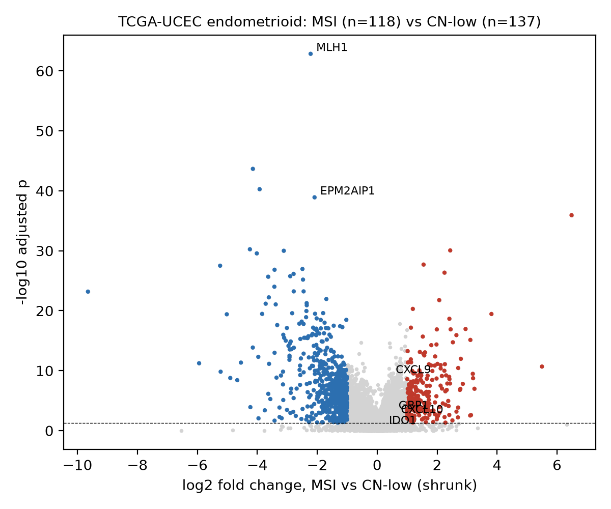
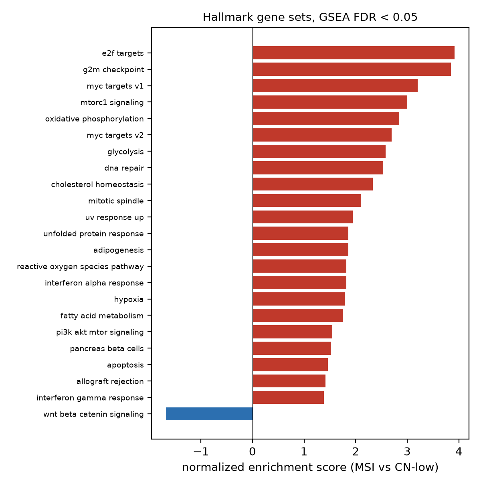
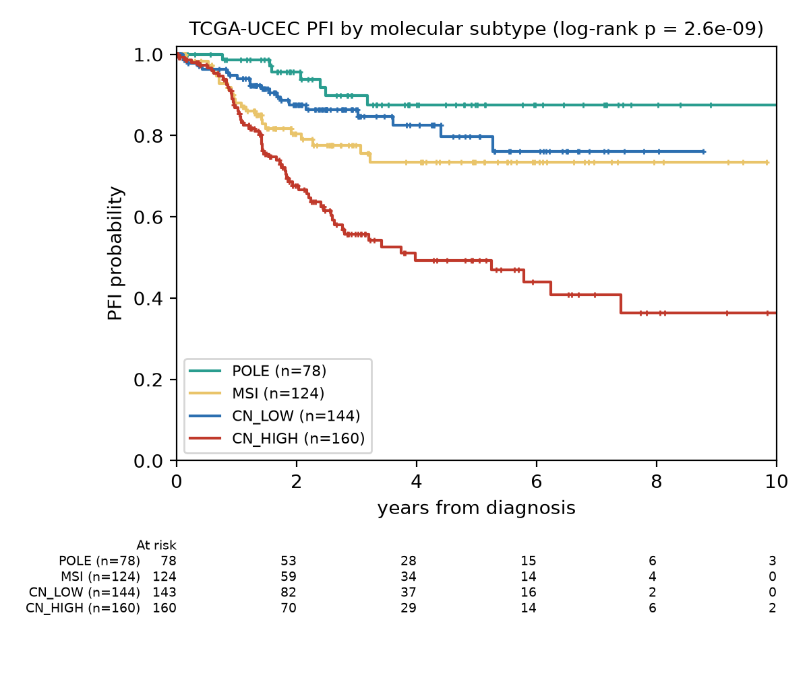
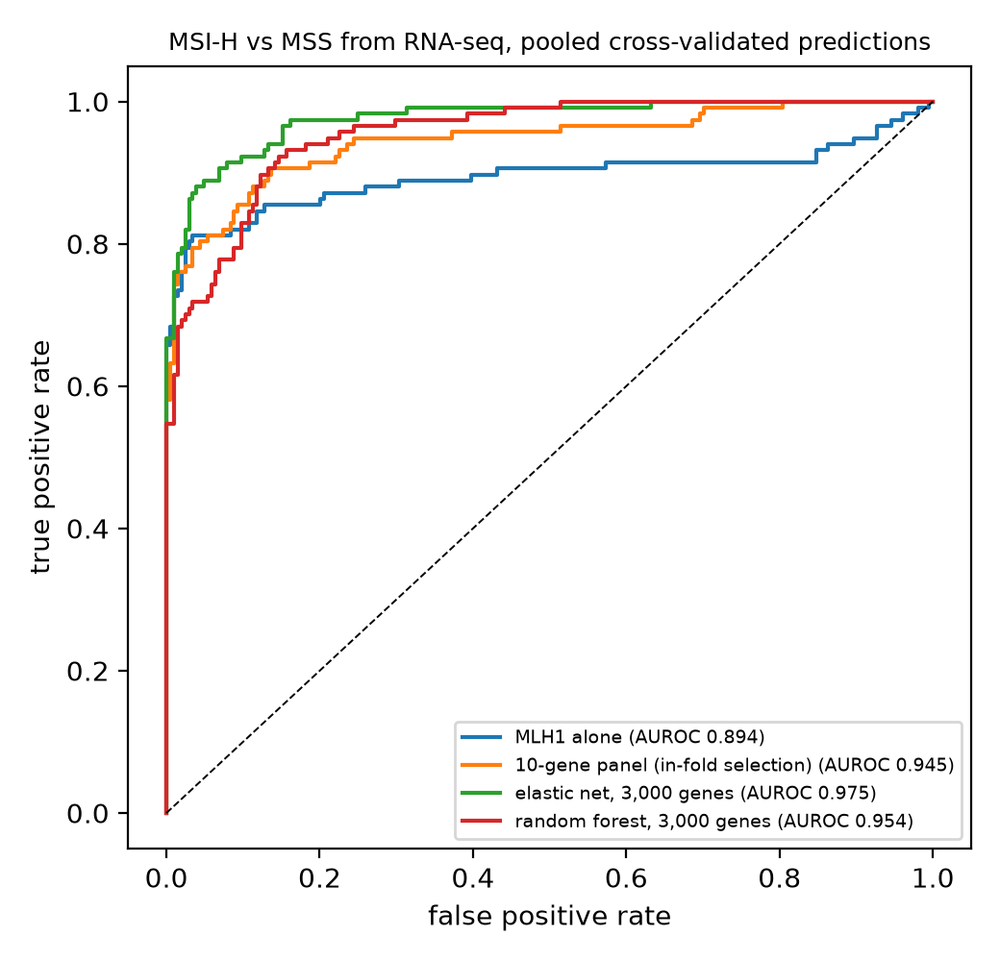

# Mismatch-repair deficiency in endometrial cancer: expression, pathways, and outcomes (TCGA-UCEC)

How do microsatellite-unstable (MSI) endometrial tumors differ from their closest molecular neighbor
in gene expression, which pathways move, and does molecular subtype predict progression? A
reproducible analysis of 507 TCGA uterine corpus endometrial carcinomas (UCEC) with RNA-seq and a
molecular subtype call.

## Data

| Input | Source |
|---|---|
| STAR gene counts (GENCODE v36) | GDC, via the UCSC Xena GDC hub |
| Molecular subtype: POLE, MSI, CN-low, CN-high | TCGA PanCanAtlas (`TCGASubtype.20170308`) |
| Age, FIGO stage, histology, OS and PFI | TCGA Clinical Data Resource (Liu et al. 2018, *Cell*) |
| Gene sets: Hallmark, Reactome, KEGG MEDICUS | MSigDB 2023.2.Hs |

Cohort: 507 primary tumors (POLE 79, MSI 124, CN-low 144, CN-high 160); 24,006 genes expressed at
≥10 counts in ≥10% of samples.

## Analyses

1. **Differential expression** (`02`): PyDESeq2, MSI vs CN-low, **restricted to endometrioid
   histology** (118 vs 137). Both groups are mostly endometrioid and copy-number quiet, so the
   contrast isolates mismatch-repair deficiency; CN-high tumors are mostly serous and would
   confound it. Log fold changes shrunk for ranking and plotting; BH-adjusted p.
2. **Gene set enrichment** (`03`): GSEA preranked on the Wald statistic (Hallmark, Reactome; 1,000
   permutations), plus over-representation (hypergeometric) of up- and down-regulated genes
   separately, against the tested genes as background.
3. **Time-to-event analysis** (`04`): Kaplan–Meier by subtype with log-rank tests (pairwise,
   Bonferroni), then a multivariable Cox model, PFI ~ subtype + age + FIGO stage, with the
   proportional-hazards assumption checked by scaled Schoenfeld residuals. PFI is the primary
   endpoint, as Liu et al. recommend for UCEC; OS is a secondary check.
4. **Batch effects and confounding** (`05`): PCA of the 2,000 most variable genes, with the share
   of each component explained by tissue source site (the contributing institution) versus MSI
   status; a chi-square test of MSI prevalence across sites; and a mixed model,
   expression ~ MSI + (1 | site), for MLH1 and the top DE genes, against ordinary least squares.
5. **MSI classifier** (`06`): predict the clinical MSI assay call (MSI-H vs MSS, n = 321, a label
   independent of the expression data) from RNA-seq. Four models from one gene to 3,000: MLH1 alone,
   a 10-gene panel selected inside each training fold, elastic-net logistic regression with the
   penalty tuned by nested CV, and a random forest. Repeated stratified 5-fold CV, then
   leave-one-site-out so a model that had learned site signatures would fall apart.

## Results

**MLH1 is the top differentially expressed gene** (4.7-fold lower in MSI, padj 1e-63), and
**EPM2AIP1**, which shares MLH1's bidirectional promoter, is fourth. That is the expected signature
of sporadic MSI endometrial cancer, where MLH1 is silenced at its promoter, and serves as a positive
control for the pipeline. The other mismatch-repair genes (MSH2, MSH6, PMS2) barely move. In total
896 genes pass padj < 0.05 and |log2FC| ≥ 1 (247 up, 649 down in MSI).



**Pathways.** GSEA finds 23 Hallmark sets at FDR < 0.05. Up in MSI: proliferation (E2F targets,
G2/M checkpoint, MYC targets), DNA repair, and immune signaling (interferon-α and -γ response,
allograft rejection), consistent with the neoantigen load of hypermutated tumors. The one set down
in MSI is **WNT/β-catenin signaling**, which fits CN-low tumors' known enrichment for CTNNB1
mutations; over-representation of the down-regulated genes adds keratinization and FGFR signaling.



**Outcomes.** Subtype separates progression-free interval (log-rank p = 2.6e-9): 5-year PFI is 0.88
for POLE, 0.80 CN-low, 0.74 MSI, and 0.49 CN-high, reproducing the TCGA 2013 ordering. Adjusted for
age and stage (n = 503, 113 events, concordance 0.70), CN-high carries a hazard ratio of 2.69
(95% CI 1.54–4.71) and POLE 0.39 (0.16–0.94) relative to CN-low; MSI vs CN-low is not significant
(1.50, 0.83–2.72). Stage III/IV: HR 2.79. No covariate violates proportional hazards (all p > 0.08).



**Batch effects.** Tissue source site explains 14% of PC1, so the institution leaves a visible
mark on expression. It is orthogonal to the biology of interest, though: MSI status explains none of
PC1, MSI-H prevalence does not differ across the nine sites with ≥ 10 labeled tumors (24–44%,
chi-square p = 0.71), and in the mixed model the between-site variance in MLH1 expression is under
1% of the residual (ICC 0.008), leaving the MSI effect and its standard error unchanged to three
decimals. The check is cheap, and here it says site would not bias the comparisons above.

**Does machine learning add anything over one gene?** MLH1 alone calls MSI-H at AUROC 0.90 and
balanced accuracy 0.89. The elastic net over 3,000 genes reaches AUROC 0.975 and balanced accuracy
0.92, keeping 151 genes led by MLH1, EPM2AIP1 and RPL22L1 (higher in MSI-H, consistent with the
RPL22 frameshift common in MSI tumors). The random forest (0.95) adds nothing over the linear model,
and the 10-gene panel sits between. Held out one site at a time, the ranking is unchanged (elastic
net 0.971, MLH1 0.892), so none of the models is reading site signatures. The judgment: a sparse
linear model earns its extra 0.08 AUROC where the call matters; a single-gene rule gets 90% with
nothing to tune, and a nonlinear model is not worth its opacity here.



## Limitations

- Subtype calls come from the TCGA consortium, not re-derived here; MSI status was called from
  sequencing at the time and the POLE call depends on exonuclease-domain mutation lists.
- TCGA follow-up is short (median under 3 years) and events are few, so the MSI vs CN-low hazard
  ratio is underpowered rather than shown to be null.
- Counts come from the Xena hub's log2(x+1) STAR counts, back-transformed to integers.
- No treatment variables: adjuvant therapy is inconsistently recorded in TCGA and is a known
  confounder of stage-specific outcomes.
- The clinical MSI assay call is missing for a third of the tumors, so the classifier is trained on
  321; the 3,000-gene variance filter is unsupervised but computed once over all labeled samples
  rather than inside each fold; and 321 samples against 3,000 features is the regime where the
  penalty, not the data, decides how many genes survive.

## Run

```bash
conda env create -f environment.yml && conda activate tcga
./run_all.sh          # downloads ~65 MB once, then runs steps 01–06 (about 4 minutes)
```

Outputs: `results/` (tables), `figures/` (plots).
